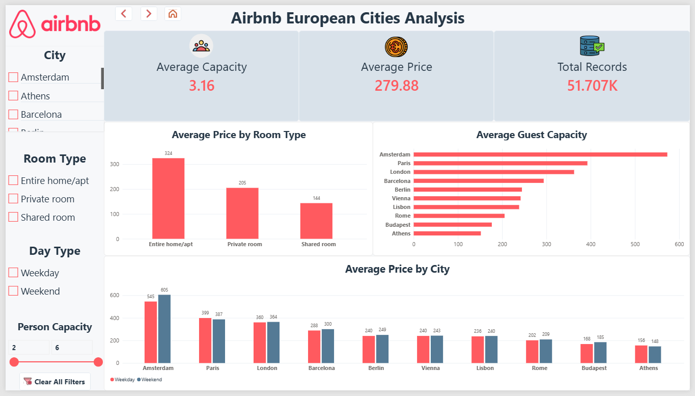
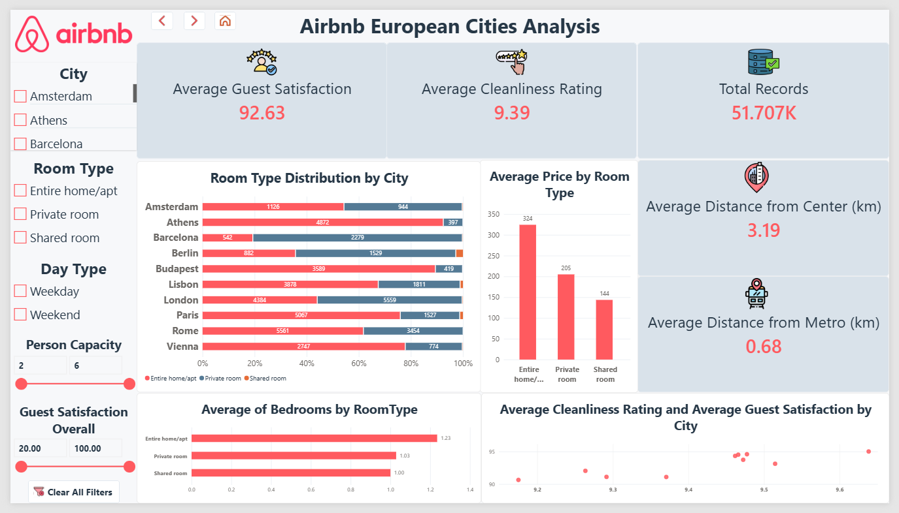

# European Airbnb Price Analysis

## Project Overview

An end-to-end data analytics project exploring Airbnb-related data across 10 European cities using SQL Server and Power BI.

The project transforms raw data into structured analytical tables and an interactive dashboard to investigate price patterns, room types, accommodation capacity, cleanliness ratings, guest satisfaction, and location-related factors.

## Project Objectives

- Compare average prices across European cities and room types.
- Explore weekday and weekend price differences.
- Analyze room type distribution and accommodation capacity.
- Examine cleanliness ratings and guest satisfaction across cities.
- Explore the relationship between accommodation prices and location-related factors.
- Build an interactive Power BI report supported by a structured SQL data model.

## Dashboard Preview

### Page 1 — Price Analysis

Explores average prices across cities and room types, compares weekday and weekend pricing, and provides interactive filters for deeper analysis.



### Page 2 — City Insights

Examines cleanliness ratings and guest satisfaction, room type distribution across cities, and average bedroom counts by room type. KPI cards and interactive slicers support further exploration.



## Dashboard Features

### Key Performance Indicators (KPIs)

- **Total Records:** Number of records available in the current filter context.
- **Average Price:** Average recorded price across the selected data.
- **Average Capacity:** Average accommodation capacity.
- **Average Guest Satisfaction:** Average overall guest satisfaction score.
- **Average Cleanliness Rating:** Average cleanliness rating.
- **Average Distance from Center:** Average distance from the city center, measured in kilometers.
- **Average Distance from Metro:** Average distance from metro stations, measured in kilometers.

### Price Analysis

- Average price comparison across cities.
- Average price comparison by room type.
- Weekday versus weekend price comparison.
- Interactive filtering by city, room type, day type, person capacity, and guest satisfaction.

### City Insights

- Comparison of average cleanliness ratings and guest satisfaction by city.
- Room type distribution across cities.
- Average bedroom count by room type.
- Interactive exploration of accommodation characteristics and location-related metrics.

## Tools & Technologies

- **SQL Server:** Data storage, SQL transformations, analytical aggregations, validation, and dimensional modeling.
- **Power BI Desktop:** Interactive dashboards and data visualization.
- **DAX:** Measures and filter-responsive analytical calculations.
- **Data Modeling:** Fact and dimension tables organized using a star schema.
- **GitHub:** Version control, project documentation, and portfolio presentation.

## Data Architecture & Project Workflow

The project follows a layered data architecture:

1. **Bronze Layer:** Imported source data, including a consolidated table.
2. **Silver Layer:** Consolidated data prepared for analysis.
3. **Gold Layer:** Aggregated analytical tables for city, room type, capacity, and day type analysis.
4. **Star Schema:** A fact table connected to City, Room Type, and Day Type dimensions.
5. **Power BI:** Data modeling, DAX measures, interactive slicers, KPI cards, and dashboard development.

## SQL Scripts

| File | Purpose |
|---|---|
| `01_Bronze.sql` | Source data consolidation |
| `02_Silver.sql` | Silver layer preparation |
| `03_Gold.sql` | Analytical aggregation tables |
| `04_StarSchema.sql` | Fact and dimension table creation |
| `05_Validation.sql` | Data quality and row-count checks |

## Data Validation Results

The SQL validation checks confirmed:

- **51,707 records** in the Bronze layer.
- **51,707 records** in the Silver layer.
- **51,707 records** in the Fact table.
- **10 cities**, **3 room types**, and **2 day types** in the dimension tables.
- No missing values in the checked key analytical columns.
- No non-positive prices detected.

These checks confirm row-count consistency across the tested layers. They do not independently establish that each source record represents a unique property listing.

## Dataset

The project uses an Airbnb-related dataset covering the following European cities:

Amsterdam, Athens, Barcelona, Berlin, Budapest, Lisbon, London, Paris, Rome, and Vienna.

**Source:** [Airbnb Prices in European Cities — Kaggle](https://www.kaggle.com/datasets/thedevastator/airbnb-prices-in-european-cities/code)

The raw dataset is excluded from version control.

## Project Structure

```text
Airbnb-European-Cities-Analysis/
├── sql/
│   ├── 01_Bronze.sql
│   ├── 02_Silver.sql
│   ├── 03_Gold.sql
│   ├── 04_StarSchema.sql
│   └── 05_Validation.sql
├── powerbi/
│   ├── Airbnb_Analysis.pbix
│   └── screenshots/
│       ├── page1_price_analysis.png
│       └── page2_city_insights.png
├── README.md
└── .gitignore
```

## Author

**Osman Ahmed Osman**  
AI & Data Solutions Engineer

- **GitHub:** [osmanahmedosman](https://github.com/osmanahmedosman)
- **LinkedIn:** [Osman Ahmed Osman](https://www.linkedin.com/in/osmanahmedosman)


